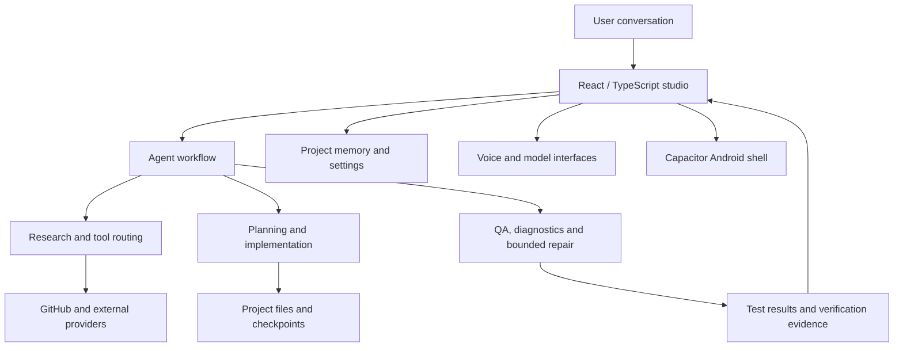

<div align="center">

# Kuro-chan 🌸

### An AI engineering companion built around conversation, real repositories, and verifiable progress.

**Bring an idea. Bring an existing codebase. Talk through the goal, inspect the project, make changes, run checks, and keep the work reviewable.**

[**⬇ Download Kurochan.apk (direct download)**](https://github.com/gtxnrg-ship-it/kuro-chan/releases/latest/download/Kurochan.apk) · [Release notes](https://github.com/gtxnrg-ship-it/kuro-chan/releases/latest) · [Roadmap](ROADMAP.md) · [Prioritized implementation plan](docs/IMPLEMENTATION_PRIORITIES.md) · [Verified feature audit](docs/FEATURE_AUDIT.md) · [Architecture & original vision](docs/ORIGINAL_VISION.md) · [Report a bug](https://github.com/gtxnrg-ship-it/kuro-chan/issues/new?template=bug_report.yml)

[](https://github.com/gtxnrg-ship-it/kuro-chan/actions/workflows/android.yml)
[](https://github.com/gtxnrg-ship-it/kuro-chan/actions/workflows/check.yml)
[](https://github.com/gtxnrg-ship-it/kuro-chan/actions/workflows/codeql.yml)
[](LICENSE)

</div>

---

## Download for Android

**[⬇ Download Kurochan.apk now](https://github.com/gtxnrg-ship-it/kuro-chan/releases/latest/download/Kurochan.apk)** — this link downloads the APK directly instead of opening the GitHub release page. The latest-release asset is published automatically after a successful push to `main`; if a new build is still running, the previous latest release remains available until the new release is published.

The file is named **`Kurochan.apk`**. It is currently a CI-built debug APK, not a Play Store-signed production release. Android may ask you to allow installation from your browser or file manager.

## Start here

Kuro-chan is an open-source, chat-first AI building studio for people who want to make software without having to become software engineers first. It is also intended for experienced developers who want a conversational front end to repository inspection, specialist agents, automated checks, and delivery workflows.

The central idea is simple:

> **The conversation is the control room. The repository is the source of truth. Tests and review are the evidence.**

Kuro-chan should be able to meet a beginner where they are, while still exposing the architecture, files, decisions, diffs, and verification details that an experienced engineer expects. The long-term ambition is not just to answer coding questions. It is to help take projects from an initial idea through research, design, implementation, testing, repair, and a reviewable deliverable.

**Current status:** active development; not yet a finished autonomous engineering system. Some foundations are implemented and covered by automated tests, some integrations need maintainer configuration or real-device verification, and several major capabilities remain planned. This README separates those categories deliberately.

## What Kuro-chan is building toward

- **One conversation for the whole project.** Discuss an idea naturally, share references, change direction, ask ordinary questions, or request a substantial build without being forced into a rigid wizard.
- **Repository-aware engineering.** Inspect a real repository's metadata, default branch, file inventory, important source files, project instructions, dependencies, scripts, and tests before proposing changes.
- **A specialist workflow.** Separate understanding, research, planning, building, and checking into focused roles, with bounded repair attempts and visible failures.
- **Useful project continuity.** Keep decisions, facts, open questions, and hand-off notes scoped to the project, inspectable and editable by the user.
- **A beginner-friendly interface.** Explain choices in plain language; make advanced details available without making every interaction look like an operations dashboard.
- **A real local-model path.** Ultimately download compatible open-weight models on demand, verify them, run them on-device, and route work to them when supported. The current catalogue is not yet a functioning local inference runtime.
- **A practical Android experience.** Build installable APKs through CI and improve reliability through automated checks and physical-device testing.

These are product goals, not a blanket claim that every bullet is complete today. The implementation boundary below is the more accurate status reference.

## What works today — and what does not

| Area | Current implementation | Important boundary |
| --- | --- | --- |
| Chat studio and interface | Responsive chat-first React interface, collapsible navigation, Kuro-chan orb identity, projects/activity views, settings hub | Real-device accessibility, responsive edge cases, and every visible action still need systematic acceptance testing |
| Project workspaces | Create/switch local projects, inspect project files, checkpoints and restore workflow, ZIP export entry points | Do not assume cloud synchronization or universal language execution |
| Project memory | Project-scoped facts and decisions, open questions, editable hand-off notes, credential-like text filtering | Not a perfect transcript of every conversation or an automatic, unlimited memory of all repositories |
| Agent workflow | Talker/Researcher/Planner/Builder/Checker architecture, tool integration, bounded workflow/QA foundations | Autonomy depends on the configured model, tool access, task size, available runners, and checks; complex builds are not guaranteed to succeed |
| Repository context | GitHub API client, repository tree inspection, bounded prioritized source-file reading, evidence-labelled context, repository diagnostics | A context pack is a bounded and prioritized view—not a literal guarantee that every byte of a large repository is loaded into a model's context window |
| GitHub sign-in | Device Flow code path, token identity verification, in-memory session boundary, automated tests | Requires a registered GitHub App with Device Flow enabled and the public client ID configured; real app/device sign-in and permission scenarios still require acceptance testing |
| GitHub engineering operations | Repository/API and inspection foundations, search and workflow tools | Do not assume the complete installation-based GitHub App experience, safe branch synchronization, every permission, or unattended PR delivery is finished |
| Voice | Local Kokoro speech-synthesis and speech integration foundations, voice controls | Natural real-time conversation, interruption, permission failures, and device-specific behavior still need physical-device validation |
| Model providers | Multi-provider routing and model configuration foundations | Availability and behavior depend on provider configuration, network access, quotas, and endpoint terms |
| Local models | Curated candidate catalogue and rough device-fit guidance | **Downloading, installing, and running the listed chat models locally is not implemented as a complete end-to-end feature.** A catalogue entry is not a runnable model |
| Android delivery | GitHub Actions workflow builds APK artifacts/releases when successful | A successful CI build does not prove the APK works on every phone; APKs are development builds, not Play Store releases |

The [roadmap](ROADMAP.md) tracks the wider implementation, the [prioritized implementation plan](docs/IMPLEMENTATION_PRIORITIES.md) ranks work by impact and dependency, the [verified feature audit](docs/FEATURE_AUDIT.md) records evidence and unverified gaps, and [roadmap progress notes](docs/ROADMAP_PROGRESS.md) explain the strict checkbox count. The current reconciled checklist is **16/151 (10.6%)** after adding explicit multi-language/scientific/game-engine acceptance gates; this is only the literal count of checked roadmap boxes, not a fair measure of how much code or capability has been built. We reconcile each checkbox against explicit acceptance evidence instead of using the checklist as a product-completion percentage. Do not interpret 10.6% as “only 10.6% of Kuro-chan exists.”

## Get the Android build

**[⬇ Download Kurochan.apk directly](https://github.com/gtxnrg-ship-it/kuro-chan/releases/latest/download/Kurochan.apk)** — tapping this link starts the APK download rather than opening the release page. The [latest release notes](https://github.com/gtxnrg-ship-it/kuro-chan/releases/latest) are available separately.

The Android workflow publishes the asset as `Kurochan.apk` after a successful push to `main`. Until the first post-merge build finishes, the existing latest release may not yet contain the renamed asset. This is a development/debug APK, not a Play Store-certified production release. Android may ask you to allow your browser or file manager to install apps from that source.

A merge does not instantly guarantee a new release. Wait for the [Android build workflow](https://github.com/gtxnrg-ship-it/kuro-chan/actions/workflows/android.yml) to finish successfully and for the release asset to appear. The [all releases page](https://github.com/gtxnrg-ship-it/kuro-chan/releases) and [workflow history](https://github.com/gtxnrg-ship-it/kuro-chan/actions) are available if you need to inspect the build evidence.

Back up important work before testing experimental builds. Report a reproducible issue using the [bug report form](https://github.com/gtxnrg-ship-it/kuro-chan/issues/new?template=bug_report.yml).

## How repository understanding is designed

An imported repository is not understood merely because Kuro-chan knows its URL or has received a list of filenames. The code distinguishes a repository inventory from the contents of the files.

The current repository-context builder:

1. Normalizes a GitHub repository URL or `owner/repository` identifier.
2. Reads repository metadata and the default branch.
3. Requests the recursive Git tree and records the visible file inventory.
4. Prioritizes likely high-value files—README and package metadata, build configuration, application entry points, source/engine files, project instructions, and tests.
5. Fetches a bounded set of actual text-file bodies, with limits on file count and context size.
6. Reports the observed commit, included/skipped counts, truncation, and warnings so the workflow can reason from evidence rather than pretending it read everything.
7. Pins the recursive file tree and source-body reads to the exact commit SHA observed for the selected ref, so a moving branch cannot silently mix different snapshots during one inspection.
8. Revalidates cached repository context against the latest selected-ref commit before reuse; if the head changes or validation fails, it rebuilds rather than treating stale context as current.

This design is meant to be both practical and honest. Large repositories can contain generated files, binary assets, vendored dependencies, and far more source than a single model request can safely absorb. A useful assistant needs prioritization, targeted follow-up reads, search, and explicit limits—not a claim of infinite context.

**Important:** repository access depends on the credentials and permissions actually granted. Private repository access is never implied by a URL alone. GitHub API limits, missing permissions, unavailable indexing, truncated trees, and large files must be surfaced as constraints.

Further detail: [Live repository intelligence](docs/LIVE_REPOSITORY_INTELLIGENCE.md) · [Repository diagnosis](docs/REPOSITORY_DIAGNOSIS.md) · [Persistent project memory](docs/PROJECT_MEMORY.md).

## GitHub sign-in: current boundary

Kuro-chan is intended to offer an understandable in-app GitHub connection rather than requiring ordinary users to paste personal access tokens. The current code includes a GitHub App Device Flow path that requests a one-time code, polls for approval, exchanges the device code, and verifies the returned token against GitHub's `/user` endpoint. The token is held in runtime memory and is not intended to be written to the ordinary AI-key store.

To enable the current flow, maintainers must register/configure a GitHub App with Device Flow enabled and set the **public** `VITE_GITHUB_APP_CLIENT_ID` value in the build environment. No client secret belongs in a browser bundle or APK. The session is currently temporary and requires reconnecting after reload or expiry.

This is **not yet** the complete installation-based GitHub App architecture. A production design for privileged installation operations needs the correct GitHub App permission model and, where installation tokens must be minted, a trusted server-side component that protects the App private key. A public client ID is not a substitute for that component.

Before calling GitHub integration production-ready, the project still needs real-device sign-in acceptance tests, private/public repository permission tests, revoked/expired-token recovery, secure session handling, and end-to-end verification of repository selection, branch-aware edits, diffs, checks, and pull requests.

See [GitHub sign-in migration and acceptance checklist](docs/GITHUB_SIGN_IN_MIGRATION.md).

## Models and voice

### Cloud model providers

Kuro-chan contains a multi-provider routing foundation. Actual model availability depends on the providers configured, network connectivity, provider policies, quotas, and the models those services expose. A label in the interface should not be treated as proof that a particular model's weights are bundled or executing locally.

### On-device models

The Local Models screen currently presents model candidates and approximate device-fit guidance. It does **not** yet provide a complete download → integrity verification → install → load → inference smoke-test → routing pipeline for those chat models.

The intended design is to download compatible artifacts on demand, display verified size/license/runtime information, support pause/cancel/retry and integrity checks, store files in app-private storage, load them through a compatible Android inference runtime, run a smoke test, and mark a model ready only after successful inference. Model updates and deletion must not delete user projects. The app should explain when a model is too large for a device instead of implying that a green device-fit estimate is a benchmark.

### Speech

Kokoro-based local text-to-speech and native speech-related integrations exist in the repository. Reliable live voice conversation still requires acceptance tests for microphone permissions, unavailable speech services, audio interruption, lifecycle changes, languages, and a range of physical Android devices.

See [cross-platform core and model runtime](docs/CROSS_PLATFORM_CORE_AND_MODEL_RUNTIME.md).

## Architecture at a glance

Kuro-chan uses a TypeScript/React/Vite front end with a modular TypeScript engine. Capacitor provides the Android packaging bridge. The intended architecture keeps user interaction, agent orchestration, providers, repository intelligence, project memory, and platform-specific behavior separated so individual subsystems can improve without rewriting the entire app.



The diagram describes the current architectural direction, not a claim that every arrow is fully autonomous or every platform adapter is complete.

### Code map

| Path | Responsibility |
| --- | --- |
| `src/components/her/` | Chat studio, assistant messages, settings, project memory, checkpoints, code and preview surfaces |
| `src/engine/agents.ts` | Agent workflow orchestration |
| `src/engine/llm.ts`, `providers.ts`, `router.ts` | Model-provider calls and routing foundations |
| `src/engine/github*.ts` | GitHub client, authentication/session and repository-related behavior |
| `src/engine/repository-context.ts` | Bounded repository inventory and source context |
| `src/engine/live-repository-intelligence.ts` | Live repository inspection/intelligence support |
| `src/engine/repository-diagnosis.ts` | Repository diagnostics |
| `src/engine/project-memory.ts`, `db.ts` | Project-scoped memory and local persistence |
| `src/engine/local-models.ts` | Candidate catalogue and device-fit estimates—not the full inference runtime |
| `src/engine/local-voice.ts` | Local voice integration |
| `src/engine/qa-harness.ts`, `workflow-failure-diagnostics.ts` | QA and workflow-failure support |
| `tests/e2e/` | Browser end-to-end tests |
| `docs/` | Architecture, integration boundaries, project memory, security, and progress notes |
| `.github/workflows/` | Automated checks, Android packaging, and CodeQL security analysis |

## Run it locally

### Requirements

- Node.js 20 or newer
- npm
- A modern browser
- Android Studio / Android SDK only if you intend to work on native packaging

### Install and start the web app

```bash
git clone https://github.com/gtxnrg-ship-it/kuro-chan.git
cd kuro-chan
npm ci
npm run dev
```

Vite prints the local development URL. Open it in your browser.

### Verify your changes

```bash
npm test
npm run check
npm run build
npx playwright install chromium
npm run e2e
```

The exact scripts and workflow steps in the checked-out commit are authoritative. Some tests or integrations may require network access, provider configuration, browser binaries, or platform tooling. A test suite passing is evidence for the tested behavior—not proof that every real-world integration or Android device works.

### GitHub sign-in configuration

For the current Device Flow path, configure `VITE_GITHUB_APP_CLIENT_ID` with the public client ID of a registered GitHub App that has Device Flow enabled. It is a public identifier, not a secret. **Never put a GitHub App private key, client secret, personal access token, or other credential into Vite variables or commit it to source control.**

See [GitHub sign-in migration](docs/GITHUB_SIGN_IN_MIGRATION.md) before changing the authorization design.

## Design principles

1. **Truth over theatre.** A feature is complete only when the implementation and its verification support that claim.
2. **Repository evidence over guesswork.** Inspect the actual files and build/test scripts; record limits and skipped material.
3. **Small, reversible changes.** Use branches, diffs, checkpoints, and tests to make failures diagnosable and recovery possible.
4. **Beginner-friendly by default.** Use plain language and sensible defaults, without hiding meaningful decisions from experienced developers.
5. **Privacy by default.** Do not silently upload project source, prompts, or transcripts as telemetry.
6. **Bounded autonomy.** Agents need explicit tool permissions, limits, cancellation, and a stopping condition—not an infinite self-repair loop.
7. **No magic claims.** A model catalogue is not inference, a repository URL is not repository access, a successful build is not device acceptance, and a roadmap is not a feature list of completed work.

## Privacy and security

Kuro-chan is browser-first, and project state/settings use local browser-side persistence in the current architecture. That does not make browser storage a secure vault on a shared or compromised device.

- Cloud providers receive the prompts, context, source, or other data required for requests you send them; their policies apply.
- Search, package registries, GitHub, and other integrations receive the requests needed to perform their functions.
- Review provider configuration and GitHub permissions before using private projects.
- Never commit API keys, tokens, private repository contents, or private user data.
- Review and redact diagnostics before sharing them publicly.
- Disconnecting a session in Kuro-chan does not necessarily revoke the app's authorization in GitHub; use GitHub's settings to revoke access when appropriate.

Read [SECURITY.md](SECURITY.md) for responsible vulnerability reporting and [Feedback & model evolution](docs/FEEDBACK_AND_MODEL_EVOLUTION.md) for the privacy-first feedback process.

## Roadmap and project documentation

- [Prioritized implementation plan](docs/IMPLEMENTATION_PRIORITIES.md) — ordered workstreams, dependency rationale, and rules to avoid duplicate rewrites.
- [Roadmap](ROADMAP.md) — current checklist and planned work.
- [Original vision and capability map](docs/ORIGINAL_VISION.md) — product goals and explicit implementation boundaries.
- [Roadmap progress notes](docs/ROADMAP_PROGRESS.md) — how progress is counted and reconciled.
- [Verified feature audit](docs/FEATURE_AUDIT.md) — workstream-by-workstream implementation evidence, unverified gaps, acceptance gates, and cross-conversation handoff.
- [Current engineering handoff](docs/CURRENT_HANDOFF.md) — exact resume point, user requirements, current PR/CI state, and next actions for a new chat.
- [Language and game-engine capabilities](docs/LANGUAGE_AND_GAME_ENGINE_CAPABILITIES.md) — supported detection scope, limitations, and acceptance gates.
- [Live repository intelligence](docs/LIVE_REPOSITORY_INTELLIGENCE.md) — repository inspection and context behavior.
- [Repository diagnosis](docs/REPOSITORY_DIAGNOSIS.md) — diagnosis workflow and limits.
- [Project memory](docs/PROJECT_MEMORY.md) and [memory integration](docs/PERSISTENT_PROJECT_MEMORY_INTEGRATION.md).
- [Cross-platform core and model runtime](docs/CROSS_PLATFORM_CORE_AND_MODEL_RUNTIME.md).
- [GitHub sign-in migration](docs/GITHUB_SIGN_IN_MIGRATION.md).
- [Feedback and model evolution](docs/FEEDBACK_AND_MODEL_EVOLUTION.md).

## Contributing

Contributions, careful bug reports, and constructive feedback are welcome.

1. Search [existing issues](https://github.com/gtxnrg-ship-it/kuro-chan/issues) before opening a duplicate.
2. Choose the [bug report](https://github.com/gtxnrg-ship-it/kuro-chan/issues/new?template=bug_report.yml), [feature request](https://github.com/gtxnrg-ship-it/kuro-chan/issues/new?template=feature_request.yml), or [feedback](https://github.com/gtxnrg-ship-it/kuro-chan/issues/new?template=feedback.yml) form.
3. Never post secrets, private repository URLs, private source code, chat transcripts, or personal data in public issues.
4. Review and redact logs before attaching them. The project does not intend to collect prompts or source code as default telemetry.
5. Keep pull requests focused, add tests for behavior changes where practical, and document limitations honestly.

See [CONTRIBUTING.md](CONTRIBUTING.md) and [CODE_OF_CONDUCT.md](CODE_OF_CONDUCT.md).

## License

Kuro-chan's project code is licensed under the [MIT License](LICENSE). This does not automatically relicense third-party dependencies, model weights, datasets, generated assets, or external services; their respective terms still apply.

---

<div align="center">

**Built for the people who have ideas—and for the engineers who want to see exactly how those ideas become software.** 🌸

</div>
